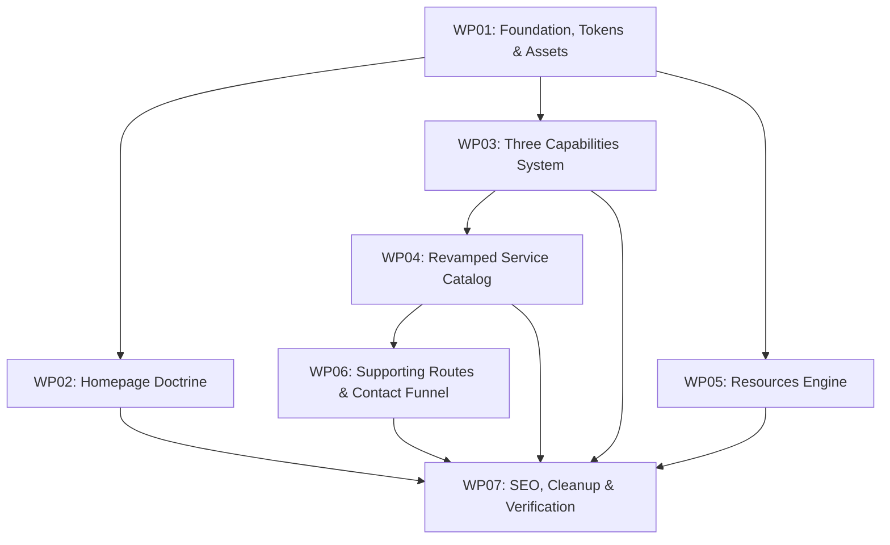

# ShiftBy v2 Website Migration Master Plan

## 1. Overview & Objective

This master plan governs the full transition of the ShiftBy.sg website from the v1 prototype/scaffold to the **v2 Architecture & Experience**, incorporating the latest authoritative documentation in [`v2docs/`](../v2docs):

* **Doctrine.md**: The foundational proposition: **Enterprise Understanding** ("*preserve, connect, retrieve, apply appropriately, and govern context through change*").
* **Three Complementary Capabilities**:
  1. **Organizational Memory** (continuity beyond individual memory).
  2. **Bounded AI** (reduced drift in AI-supported reasoning and execution).
  3. **Human–AI Accountability** (sustained human and organizational answerability).
  *(Note: Adaptive Execution was reclassified as an operating outcome of the three, and Decision Traceability was integrated as an assurance dimension).*
* **Individual Capability Routes**: Dedicated deep-dive pages for each capability (`/capabilities/[slug]`) linked via a shared capability switcher strip.
* **Service Catalog.md**: Complete revamp of `/services` into 7 defined offerings with concrete scopes, "Typical outputs", clear engagement models, and query-parameter intent passing to the contact funnel.
* **Resources & Insights Section**: A new content-driven hub (`/resources`) for doctrine essays, executive briefs, and method explorations (reframing legacy prototypes).
* **Legacy Route Governance**: Permanent 308 redirect from `/where-shiftby-helps` to `/capabilities`, and reframing `/explorations` into `/resources`.
* **Technical Debt Elimination**: Eradication of the 6,400-line `page-materialization.css`, modular CSS migration (`.module.css`), 2.5 MB logo asset optimization, and unified metadata.

---

## 2. Workpacket Registry

| Workpacket ID | Title | Scope | Dependencies | Status |
| :--- | :--- | :--- | :--- | :--- |
| [**WP01**](./WP01-foundation-tokens-assets.md) | **Core Architecture, Design Tokens & Asset Optimization** | Logo replacement (vector SVG), design tokens, modular CSS setup, layout shell | None | **Completed** (`d7bc7fe`) |
| [**WP02**](./WP02-homepage-and-doctrine.md) | **Homepage Doctrine & Enterprise Understanding** | Homepage rewrite, 3 capabilities preview, persona buying cues, services preview, doctrine mark | WP01 | **Completed** (`a0f3f4f`) |
| [**WP03**](./WP03-three-capabilities-system.md) | **Three Capabilities Hub & Dedicated Routes** | `/capabilities` hub + 3 dedicated sub-pages, capability switcher strip, legacy route redirect | WP01 | **Completed** (`31dfb58`) |
| [**WP04**](./WP04-revamped-service-catalog.md) | **Revamped Service Catalog & Engagement Model** | Rebuild `/services` with 7 offerings, typical outputs, engagement process, and `?service=` intent passing | WP01, WP03 | **Completed** (`4a5dba1`) |
| [**WP05**](./WP05-resources-and-insights-engine.md) | **Resources & Insights Content Engine** | `/resources` hub, `/resources/[slug]` dynamic route, React 19-safe parser, reframe explorations | WP01 | **Completed** (`e235a93`) |
| [**WP06**](./WP06-supporting-routes-and-contact-funnel.md) | **Supporting Routes & Contact Funnel Optimization** | `/about`, `/contact` (with intent listener & timeline), `/perspective`, `/ai-policy`, external link security | WP01, WP04 | **Completed** (`32510c4`) |
| [**WP07**](./WP07-seo-metadata-and-cleanup.md) | **SEO Harmonization, CSS Decommissioning & Verification** | Metadata unification, Schema.org normalization, legacy CSS pruning, validation suite manifest update | All WPs | **Completed** |

---

## 3. Execution Dependency Graph

---

## 4. Architectural Rules for v2 Implementation

1. **No Monolithic Stylesheets**:
   * Do NOT add rules to `styles/page-materialization.css` or import page CSS into `app/globals.css`.
   * Use CSS Modules (`[feature].module.css`) for all new and refactored components to ensure zero cascade pollution and optimal bundle splitting.
2. **Strict Metadata Registry**:
   * Every public route must export metadata generated via `getPageMetadata()` from `lib/metadata.ts`.
   * All OpenGraph images, titles, descriptions, and canonical URLs must be verified.
3. **Content Authority**:
   * All doctrinal definitions, capability descriptions, and service scope offerings must cite and maintain fidelity to `v2docs/`.
4. **Performance & Asset Budgets**:
   * All vector marks must be SVGs; images must be optimized WebP/AVIF (< 25 KB critical asset budget).
   * React 19 compatibility must be preserved across all markdown and content utilities.
   * Lighthouse targets: Performance >= 90, Accessibility >= 95, Best Practices >= 95, SEO >= 95.
